<p align="center">
  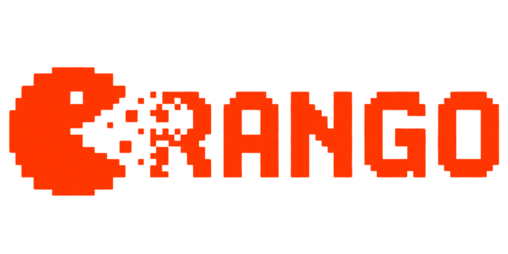
</p>

<p align="center">
  
  
  
  
  
  
</p>

<h1 align="center">RANGO — Cantina Digital SESI/SENAI</h1>

<p align="center">
  <b>Pediu, chegou.</b><br>
  Sistema de autoatendimento para facilitar os pedidos e organizar o funcionamento da cantina escolar.
</p>

---

## Sobre o projeto

O **RANGO** é um sistema desenvolvido para tornar o atendimento da cantina escolar mais simples e organizado. A plataforma permite que os alunos façam pedidos presencialmente, por meio de um totem, ou pelo celular. Enquanto isso, a equipe da cantina acompanha os pedidos e gerencia as atividades do estabelecimento em um painel administrativo.

O sistema é dividido em três partes que trabalham de forma integrada: o **Totem**, utilizado pelos alunos na própria cantina para consultar os produtos, montar o pedido e realizar o pagamento; o **Aplicativo do Aluno**, que oferece essas funcionalidades pelo celular e também permite acompanhar pedidos, utilizar cupons e acumular pontos; e o **Painel Administrativo**, usado pela equipe para acompanhar os pedidos, organizar a preparação na cozinha, controlar o estoque e consultar informações financeiras.

## O totem físico

Além da versão web, o RANGO foi pensado para funcionar em um totem de autoatendimento instalado no espaço da cantina. A proposta é que o aluno consiga realizar o pedido diretamente no equipamento, sem precisar aguardar o atendimento no balcão. A interface foi desenvolvida para permitir a navegação pelo catálogo, a seleção dos produtos, a conferência do carrinho e a finalização do pedido.

O equipamento físico representa a parte presencial do projeto e conecta a experiência de uso do sistema à rotina da cantina. A imagem abaixo ficará reservada para apresentar o totem montado.

<p align="center">
  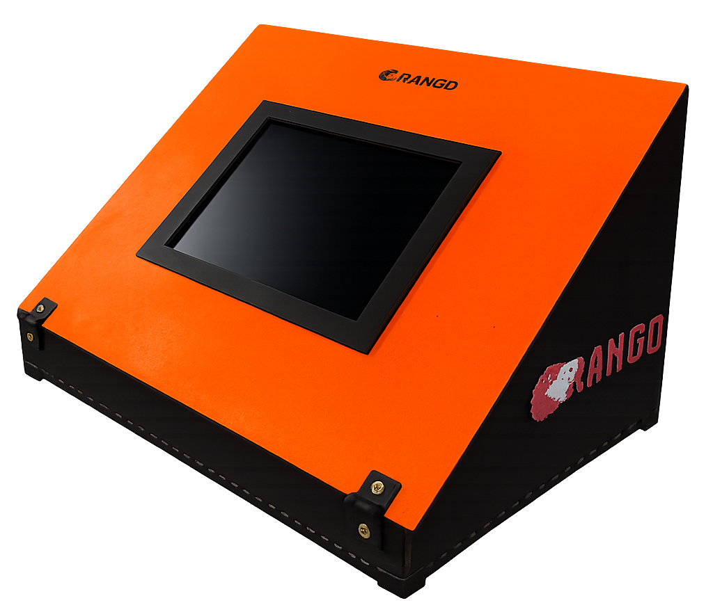
</p>
<p align="center"><em>Totem físico desenvolvido para o sistema RANGO.</em></p>

## Acesse o sistema

A versão online do RANGO está disponível em: 
<p align="left">
  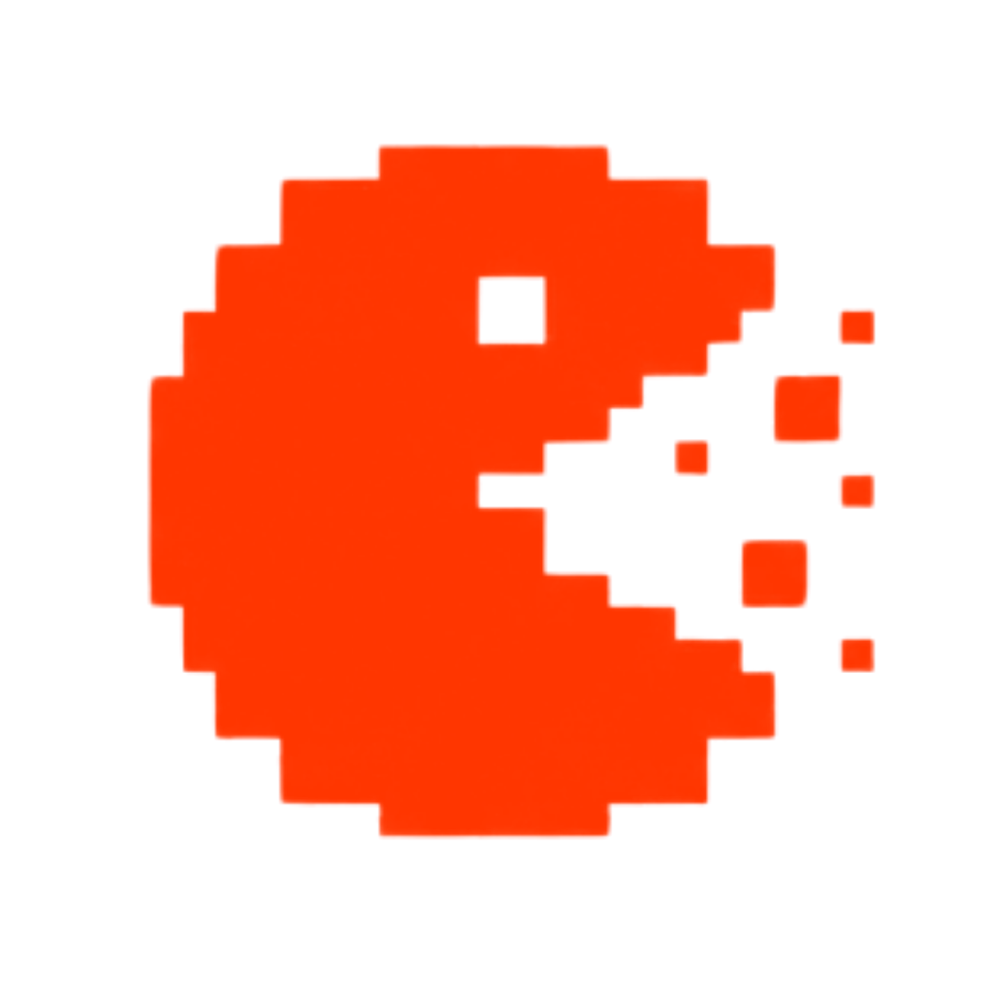
  [https://rango.page.gd/](https://rango.page.gd/).
</p>
Pelo site, é possível acessar a plataforma e conhecer sua interface.

## Telas do sistema

As telas a seguir mostram as principais áreas do RANGO e como cada uma atende às necessidades dos alunos e da equipe da cantina.

### Totem de autoatendimento


<p align="center">
  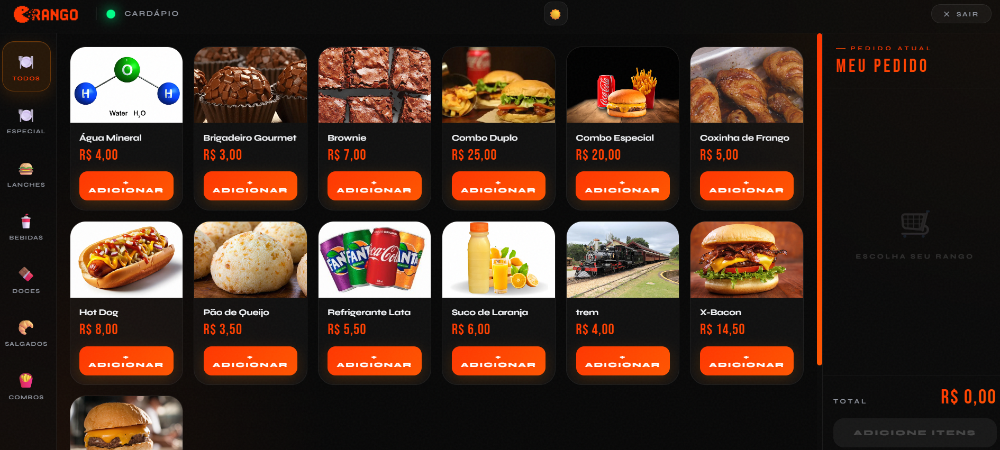
</p>
<p align="center"><em>Interface do totem, utilizada para consultar o cardápio, escolher produtos e realizar pedidos diretamente na cantina.</em></p>

### Aplicativo do Aluno

<table>
  <tr>
    <td align="center" width="33%">
      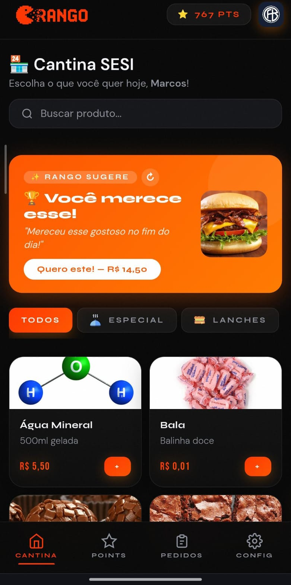
    </td>
    <td align="center" width="33%">
      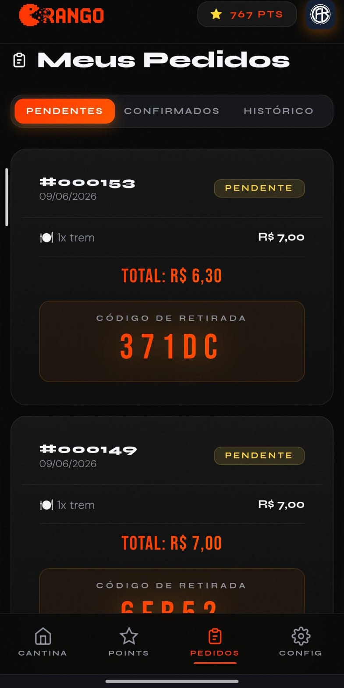
    </td>
    <td align="center" width="33%">
      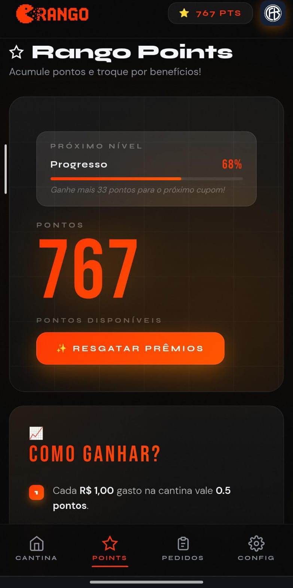
    </td>
  </tr>
  <tr>
    <td align="center"><b>Cardápio</b><br>Área em que o aluno consulta os produtos disponíveis e escolhe o que deseja pedir.</td>
    <td align="center"><b>Pedidos</b><br>Consulta dos pedidos realizados e acompanhamento das informações de cada compra.</td>
    <td align="center"><b>Rango Points</b><br>Área destinada à visualização dos pontos acumulados pelo aluno.</td>
  </tr>
</table>

### Painel Administrativo

O painel administrativo reúne as ferramentas utilizadas no dia a dia da cantina. Nele, a equipe consegue acompanhar o movimento, visualizar os pedidos que precisam ser preparados, atualizar produtos e consultar os resultados financeiros.

<table>
  <tr>
    <td align="center" width="50%">
      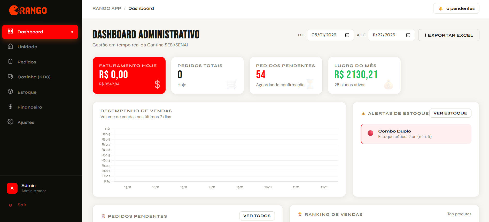
    </td>
    <td align="center" width="50%">
      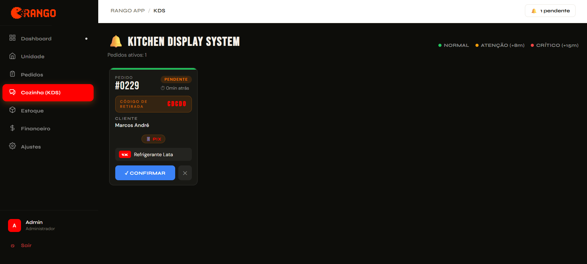
    </td>
  </tr>
  <tr>
    <td align="center"><b>Dashboard</b><br>Visão geral do estabelecimento, com informações sobre faturamento, quantidade de pedidos e alertas de estoque.</td>
    <td align="center"><b>Painel da cozinha (KDS)</b><br>Exibe os pedidos para a equipe acompanhar a preparação e organizar a ordem de atendimento.</td>
  </tr>
  <tr>
    <td align="center" width="50%">
      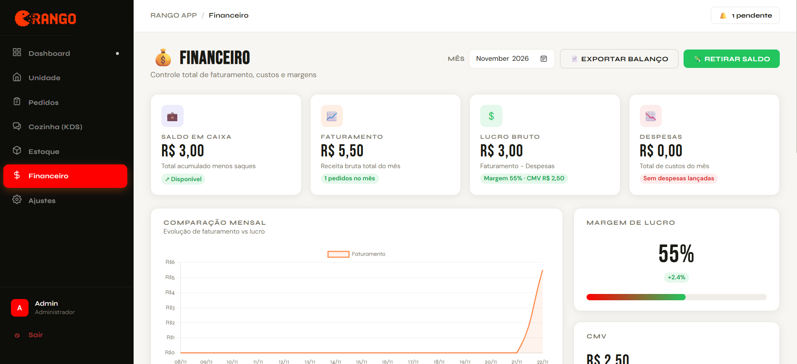
    </td>
    <td align="center" width="50%">
      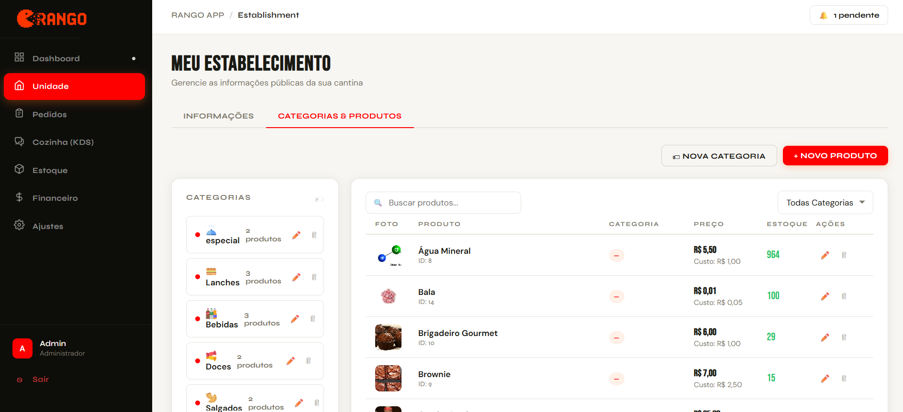
    </td>
  </tr>
  <tr>
    <td align="center"><b>Financeiro</b><br>Apresenta dados de lucro bruto, CMV, margem, despesas e retiradas para ajudar no controle financeiro.</td>
    <td align="center"><b>Estabelecimento</b><br>Permite configurar informações da cantina, horários e dias de funcionamento.</td>
  </tr>
</table>

## Funcionalidades

No aplicativo, o aluno pode criar uma conta com validação de CPF e aceite dos Termos de Uso, consultar o catálogo de produtos, montar o carrinho e pagar por PIX (QR Code), cartão, dinheiro ou Tap to Pay. Também estão disponíveis cupons de desconto, o programa de pontos Rango Points e um código de retirada para cada pedido. Quando o pedido fica pronto, o sistema pode emitir uma notificação sonora. A interface conta ainda com opções de tema claro e escuro.

No totem, o aluno realiza o pedido presencialmente por um fluxo de autoatendimento que não exige login. O pagamento por PIX pode ter a confirmação automática no ambiente de produção. Durante os testes em sandbox, a confirmação pode ser simulada pelo botão **“Já paguei!”**. O totem também oferece os modos claro e escuro.

Para a equipe da cantina, o painel administrativo apresenta um dashboard com dados de faturamento, pedidos e alertas de estoque. A área de cozinha, chamada **KDS (Kitchen Display System)**, organiza os pedidos considerando o tempo de espera. O painel também permite cadastrar e editar produtos e categorias, controlar o estoque, consultar informações financeiras — como lucro bruto, CMV, margem, despesas e retiradas — e exportar relatórios formatados para Excel. As configurações do estabelecimento incluem horários e dias de funcionamento.

## Tecnologias utilizadas

O frontend foi desenvolvido com **HTML, CSS e JavaScript puro**, sem a utilização de frameworks. No backend, o sistema utiliza **PHP 8.2**, com uma API REST responsável pela comunicação entre as telas e o banco de dados **MySQL**. Para os pagamentos via PIX, foi integrada a plataforma [Asaas](https://www.asaas.com). Os relatórios em Excel utilizam ExcelJS e os gráficos do painel são construídos com Chart.js. O projeto está preparado para hospedagem em ambiente compatível com PHP, tendo sido utilizada a InfinityFree.

## Estrutura do projeto

```text
rango-cantina-digital/
├── LICENSE
├── README.md
├── .gitignore
│
├── public/
│   ├── .htaccess
│   ├── index.html
│   ├── rango-login.html
│   ├── rango-app-aluno.html
│   ├── rango-totem.html
│   ├── rango-admin.html
│   ├── api/
│   └── assets/
│       ├── css/
│       ├── img/
│       ├── js/
│       └── docs/
│
├── database/
│   └── rango.sql
│
└── docs/
    ├── LEIA-ME.md
    └── img/
```

## Como executar o projeto

Primeiro, clone o repositório:

```bash
git clone https://github.com/SEU_USUARIO/rango-cantina-digital.git
```

Depois, crie o banco de dados MySQL e importe o arquivo SQL disponibilizado no diretório `database/`. Configure as credenciais de acesso ao banco e a chave da API do Asaas no arquivo de configuração do projeto. Em seguida, execute o sistema em um servidor com PHP 8 ou superior, como Apache com XAMPP ou uma hospedagem compatível. Com o servidor configurado, acesse a página `rango-login.html` pelo navegador.

> **Atenção:** não envie o arquivo de configuração com credenciais para o repositório. Ele contém dados de acesso ao banco e a chave da API de pagamento.

## Ambientes de pagamento

A integração com o Asaas possui dois ambientes. O **sandbox** é utilizado para testes e deve receber uma chave gerada na plataforma de testes do Asaas. Já o ambiente de **produção** utiliza a chave real da conta. A configuração é definida pela variável `ASAAS_AMBIENTE`.

| Ambiente | `ASAAS_AMBIENTE` | Chave |
|---|---|---|
| Sandbox (testes) | `sandbox` | Chave gerada em [sandbox.asaas.com](https://sandbox.asaas.com) |
| Produção | `producao` | Chave real da conta Asaas |

No ambiente sandbox, o totem disponibiliza o botão **“Já paguei!”** para simular a confirmação do pagamento por PIX durante os testes.

## Segurança e LGPD

O cadastro dos alunos conta com validação de CPF e aceite obrigatório dos Termos de Uso. As senhas são armazenadas utilizando hash, e os dados pessoais são utilizados nas operações necessárias ao funcionamento do sistema, como autenticação, pedidos e pagamentos.

## Autor

**Marcos** — Engenharia de Computação (UFOP)

Projeto desenvolvido para a cantina SESI/SENAI.

<!-- Adicione aqui links profissionais, como GitHub ou LinkedIn. -->

## Licença

Este projeto está sob a licença **MIT**. Consulte o arquivo `LICENSE` para mais informações.
